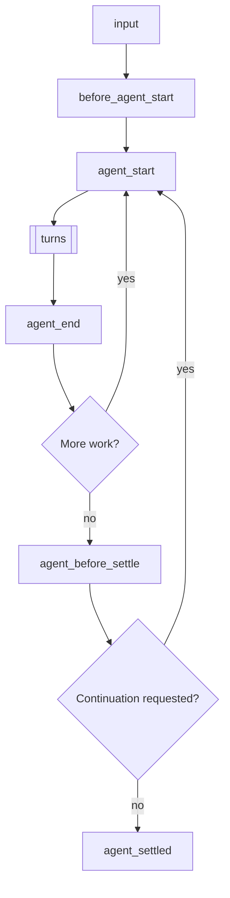
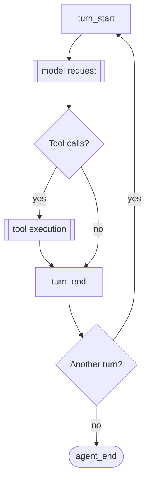
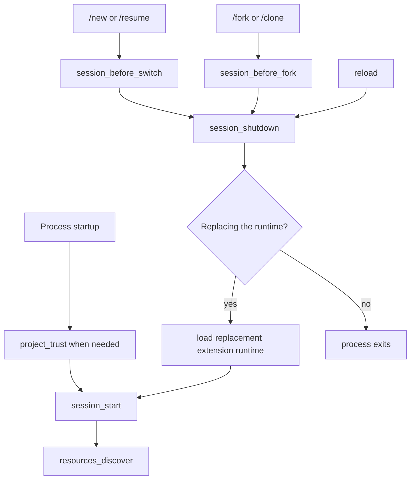

# Extensions

Extensions are TypeScript modules that add executable behavior to Pi. Use one when a workflow needs tools, commands, event handlers, model providers, session state, or terminal UI rather than instructions alone.

An extension runs inside the Pi process with the same operating-system permissions. It can inspect prompts, tool calls, files, credentials, and session history, so load extensions only from sources you trust.

Typical extensions add an agent tool, protect paths, confirm dangerous commands, react to session events, modify context, expose a command, or display persistent status.

<a id="quick-start"></a>
<a id="writing-an-extension"></a>
<a id="create-an-extension"></a>

## Create and load an extension

An extension exports a default factory that receives `ExtensionAPI`. The factory registers capabilities for the current extension runtime.

Create `~/.pi/agent/extensions/hello.ts`:

```typescript
import type { ExtensionAPI } from "@earendil-works/pi-coding-agent";

export default function (pi: ExtensionAPI) {
  pi.registerCommand("hello", {
    description: "Show a greeting",
    handler: async (name, ctx) => {
      ctx.ui.notify(`Hello, ${name || "world"}!`, "info");
    },
  });
}
```

Start Pi and run `/hello`. During development, load a file directly:

```bash
pi --extension ./hello.ts
```

Pi uses `jiti`, so local TypeScript extensions do not need a separate compilation step. Use [Pi packages](packages.md) for distributed extensions and dependencies.

<a id="extension-locations"></a>
<a id="available-imports"></a>
<a id="choose-where-it-loads"></a>

## Add it to Pi

Place the extension in your user or project extensions directory. Pi loads direct TypeScript or JavaScript files and subdirectories containing an `index.ts` or `index.js` entry point.

Use a single file for a small extension and a directory for a multi-file implementation. Put npm dependencies in a nearby `package.json`. See [Configuration](configuration.md) for conventional locations and [Settings](settings.md#resources) for additional paths.

Reload replaces the extension runtime, so code after `await ctx.reload()` must not reuse state from the old runtime. Only personal and explicit command-line extensions can participate in the `project_trust` event that runs before project extensions load.

<a id="understand-the-lifecycle"></a>

## Understand the runtime lifecycle

The factory can be synchronous or asynchronous. Pi waits for an asynchronous factory before startup continues, allowing it to fetch configuration or register providers needed during startup.

Do not start processes, sockets, watchers, or timers in the factory because some invocations load extensions without starting a session.
Start long-lived resources from `session_start` or from the command or tool that needs them.
Close session-scoped resources from an idempotent `session_shutdown` handler.

A normal prompt starts a run. The run repeats turns, then checks whether more work starts another low-level agent run:



More work means a retry, recovery, compaction retry, or queued work.

Each turn sends one model request and executes the tool calls in the assistant response:



The model request runs these hooks in order:

1. `context`
2. `context_with_system`
3. `before_provider_headers`
4. `before_provider_request`
5. `after_provider_response`
6. `provider_stream_event` and assistant message events

Tool execution runs these hooks in order for each tool call:

1. `tool_execution_start`
2. `tool_call`
3. `tool_execution_update` while the tool executes
4. `tool_result`
5. `tool_execution_end`

The lifecycle involves these event groups:

| Area | Events |
|---|---|
| Input preparation | `input`, `before_agent_start` |
| Agent run | `agent_start`, `agent_end` |
| Model turn | `turn_start`, `context`, `context_with_system`, `turn_end` |
| Provider call | `before_provider_headers`, `before_provider_request`, `after_provider_response`, `provider_stream_event` |
| Message lifecycle | `message_start`, `message_update`, `message_end` |
| Tool execution | `tool_execution_start`, `tool_call`, `tool_execution_update`, `tool_result`, `tool_execution_end` |
| Settlement | `agent_before_settle`, `agent_settled` |

Pi counts as busy while a run starts, including the compaction check and `before_agent_start`, so messages sent meanwhile go into the starting run. Message lifecycle events also cover user and tool-result messages; the model request list places only the assistant stream where it occurs in each turn.

Tool hooks run for each tool call, and one assistant response can start another turn by returning tool calls. Provider hooks run only when that transport exposes the corresponding stage. See the exported declarations in [`extensions/types.ts`](https://github.com/earendil-works/pi/blob/main/packages/coding-agent/src/core/extensions/types.ts) for exact event payloads and result types.

Session startup and replacement follow a separate lifecycle:



`project_trust` runs before trusted project resources load and can run again when session replacement enters a new working directory. Retries, recovery, compaction, and queued messages can start another agent run after `agent_end`, so `agent_end` is not a final-idle signal. Reload and session replacement invalidate the old runtime. Code after `await ctx.reload()` still belongs to the old runtime and must not reuse its session-bound state.

### Choose an event by intent

| Goal | Event |
|---|---|
| Inspect, transform, or consume raw user input | `input` |
| Change prompt sections, active tools, or add context before a run | `before_agent_start` |
| Observe one low-level agent run | `agent_start`, `agent_end` |
| Act after one model response and its tool calls | `turn_end` |
| Filter conversation messages for one provider request | `context` |
| Transform the complete transcript, including system messages | `context_with_system` |
| Change request headers or the serialized provider payload | `before_provider_headers`, `before_provider_request` |
| Observe provider response metadata or parsed stream events | `after_provider_response`, `provider_stream_event` |
| Authorize or modify a tool call | `tool_call` |
| Redact, annotate, or replace a tool result | `tool_result` |
| Append final entries or request one last continuation | `agent_before_settle` |
| Run notification work after automatic processing has stopped | `agent_settled` |
| Initialize or release session-scoped resources | `session_start`, `session_shutdown` |

<a id="agent_start--agent_end--agent_before_settle--agent_settled"></a>

Use `agent_before_settle` when an extension must append entries or request one final continuation. Use `agent_settled` for notification-only work that should run after Pi has no automatic continuation remaining.

<a id="extensionapi-methods"></a>

## Choose an integration point

| Capability | Main API |
|---|---|
| Observe or modify lifecycle behavior | `pi.on()` |
| Add a model-callable operation | `pi.registerTool()` |
| Add a `/` command | `pi.registerCommand()` |
| Add a shortcut or CLI flag | `pi.registerShortcut()` or `pi.registerFlag()` |
| Send user or custom messages | `pi.sendUserMessage()` or `pi.sendMessage()` |
| Persist non-context session data | `pi.appendEntry()` |
| Change active tools, model, or thinking level | Session control methods on `pi` |
| Add a model provider | `pi.registerProvider()` |
| Add an MCP server | `pi.registerMcpServer()` |
| Route each request to a model | [`pi.registerVirtualModel()`](virtual-models.md) |
| Add terminal rendering | Renderer registration and `ctx.ui` |
| Communicate with another extension | `pi.events` |

Use the exported declarations in [`extensions/types.ts`](https://github.com/earendil-works/pi/blob/main/packages/coding-agent/src/core/extensions/types.ts) for exact event, context, tool, and result types.

## Follow the extension contracts

<a id="events"></a>
<a id="work-with-events"></a>

### Events and concurrency

Handlers run in extension load and registration order. `pi.on()` returns a function that unsubscribes that registration; changes do not affect a dispatch already in progress.
Some events notify; others transform data, replace results, or cancel an operation.
Use each event’s declared result type rather than assuming every return value has an effect.

Events cover resource discovery, sessions, agent and message lifecycle, providers, tools, and raw input.

#### Understand handler composition

| Pattern | Behavior |
|---|---|
| Notification | Return values are ignored. Use the event for observation only. |
| In-place mutation | Later handlers see changes to values such as `before_provider_headers.headers`, `before_agent_start.systemPromptOptions`, and `tool_call.input`. |
| Chained transformation | Later handlers receive the value returned by earlier `input`, `context`, `context_with_system`, `message_end`, `tool_result`, and `before_provider_request` handlers. |
| Gate | A handled input, blocked tool call, cancelled session operation, or handled `user_bash` command stops that operation's normal fallback path. |
| Actionable boundary | Each `turn_end` or `agent_before_settle` handler sees the entries and continuation decision proposed so far. |
| Last override | The last `cache_warming_decision` handler that returns an action wins. |

Notification handlers should not perform slow work on a streaming event. Transform handlers should preserve fields they do not intentionally own, and gate handlers should fail closed when their safety decision cannot be made.

`before_agent_start` exposes both the current prompt and its structured `systemPromptOptions`. `event.messageType` says what started the run: `"user"` for a prompt or `pi.sendUserMessage()`, with `prompt` and `images`; `"custom"` for `pi.sendMessage(..., { triggerTurn: true })`, with the starting `message` and no `prompt`. A returned `message` is added to either kind of run; check `messageType` to skip runs started by custom messages. Prefer changing prompt sections, selected tools, or guidelines so Pi can append a transcript delta. Returning `systemPrompt`, or setting `forceSystemPrompt`, replaces the whole prompt for that run while the transcript continues recording the structured sections. Providers receive the forced text as their leading system prompt.

`message_end` can replace a finalized message while preserving its role. `tool_call` can mutate input or block execution. `tool_result` handlers compose, with each handler seeing prior changes.

<a id="provider_stream_event"></a>

`provider_stream_event` fires for each parsed provider stream event before Pi normalizes it. The event identifies the provider, API, and model; `event.data` is the earliest structured value available to Pi, not necessarily the original HTTP bytes or SSE frame. Treat it as read-only because mutation can affect normalization. The event is notification-only and is not persisted.

Handlers are awaited in stream order, so slow handlers delay stream consumption. Handler errors are reported without changing the provider response. See [`debug-provider.ts`](../examples/extensions/debug-provider.ts) for an opt-in viewer that groups raw events by assistant message.

<a id="context_with_system"></a>

`context` transforms conversation messages without prompt and tool system messages; Pi restores that state afterward. Use `context_with_system` only when a request-local transformation must own the complete transcript, and keep a system message at index zero.

`turn_end` and `agent_before_settle` are actionable boundaries. Their handlers can chain proposed `custom`, `custom_message`, `context_edit`, or `compaction` entries and return `continue: true` for one next model request. Guard continuation conditions because an unconditional continuation can loop. Use the exported event declarations for the complete validation and ordering contract.

<a id="cache_warming_decision"></a>

`cache_warming_decision` can override an idle prompt-cache refresh with `{ action: "warm" }` or `{ action: "stop" }`. The last handler that returns an action wins.

Tool calls from one assistant message can run in parallel.
Do not assume a sibling call or result exists when another tool event runs.
Use `ctx.signal` for nested work owned by an active turn; commands and idle session events often have no operation signal.

A `user_bash` handler that returns `undefined` passes the command to the next handler and then to local execution if no handler handles it. Returning `operations` or `result` stops propagation. A handler failure blocks the command rather than falling through to local execution.

<a id="custom-tools"></a>
<a id="register-tools"></a>

### Tools

A custom tool defines a name, model-facing description, TypeBox parameter schema, and `execute()` function.
Its result requires model-facing `content` and a `details` field for rendering or state reconstruction.
Use `details: undefined` when there are no structured details. If the tool makes nested model calls, include their `usage` in the result so session totals remain accurate.

Throw from `execute()` to produce a failed tool result.
Returning an object does not mark it as an error.
Return `terminate: true` only when the agent should skip its automatic follow-up after every completed tool in that batch agrees to terminate.

Use sequential execution when tools share mutable in-memory state.
File-mutating tools should wrap the complete read-modify-write operation with `withFileMutationQueue()`.
Truncate large model-facing results and tell the model where to read the complete output.

Declare `outputSchema` and return a matching `structuredContent` when the result is data. The model still receives `content`; programmatic callers such as codemode scripts receive `structuredContent` instead of the text. Tools without `outputSchema` are passed to scripts as their text content. To report a failure that still carries data, return the result with `isError: true` instead of throwing: the model sees an error, and scripts still receive `structuredContent`.

A tool can run other tools with `ctx.executeTool(name, args, { signal, onUpdate })`. Nested calls go through argument validation and the `tool_call` and `tool_result` handlers like model-issued calls, and emit `tool_execution_start`, `tool_execution_update`, and `tool_execution_end`; all of these events carry `parentToolCallId`, and their `toolCallId` is assigned by pi as `<parent id>/<n>`. These ids do not appear as tool calls or tool results in the transcript. Nested calls do not add transcript entries: their results only reach the calling tool, which reports them itself, for example through `onUpdate` and `details`. The session keeps a bounded record of them (name, arguments, status, duration, error; never results) as `nestedCalls` on the calling tool's result message. It is used for compaction file lists and shown in HTML exports. Arguments over 8 KiB per call or 32 KiB per tool result are omitted, at most 256 calls are kept, and `complete: false` marks a record that lost anything. The `usage` of nested results, at every depth, is added to the calling tool's result `usage`, so a tool reports only its own usage, not that of the tools it called. `ctx.tools` lists the tools `ctx.executeTool()` can call. `tool_result` handlers that redact `content` should also replace `structuredContent`; replacing only `content` drops it.

See [`hello.ts`](../examples/extensions/hello.ts), [`todo.ts`](../examples/extensions/todo.ts), [`dynamic-tools.ts`](../examples/extensions/dynamic-tools.ts), and [`truncated-tool.ts`](../examples/extensions/truncated-tool.ts).

### Tool exposure

`exposure` controls how the model reaches a tool. "Callable" means callable from other tools through `ctx.executeTool()` (`ctx.tools`), as the `codemode` tool's scripts do:

- `direct` (default): declared to the model while active, and callable while active.
- `model-only`: declared to the model while active, never callable. Use it for tools that orchestrate other tools or ask the user.
- `codemode`: callable whenever registered, and listed by the `codemode` tool. Not declared to the model unless activated explicitly.
- `deferred`: like `codemode`, but codemode tools do not list it; `tool_search` can find and activate it.
- `hidden`: registered but unreachable. Re-register a tool with `exposure: "hidden"` to withdraw it, since tools cannot be unregistered.

`namespace: { name, aliases, description, instructions }` groups related tools, as MCP servers do. Codemode tools list a namespace under one heading with its `description`. `instructions` holds longer usage guidance; it is not listed, and codemode scripts read it with `describeNamespace(name)`. `aliases` are other names scripts may look the namespace up by, for example the server name `docs` for `mcp__docs`; a name and the same name as a script identifier (`my-docs`, `my_docs`) match alike.

Registering a `direct` or `model-only` tool activates it; the other exposures are not activated on registration. The active set (`pi.getActiveTools()`, `pi.setActiveTools()`) is the set of tools declared to the model. `pi.getAllTools()` reports each tool's `exposure`, `namespace`, `annotations`, and `reachesTools`.

`annotations` are hints about what a tool does, with the meaning of MCP tool annotations: `readOnlyHint`, `destructiveHint`, `idempotentHint`, and `openWorldHint`. MCP tools carry the hints their server declares. Missing hints take the MCP defaults: a tool is not read-only, and may be destructive and reach an open world. The hints are not verified, but a permission extension can use them to decide which calls to confirm. This confirms the calls Codex asks approval for:

```typescript
pi.on("tool_call", async (event, ctx) => {
  const hints = pi.getAllTools().find((tool) => tool.name === event.toolName)?.annotations;
  const needsApproval =
    hints?.destructiveHint === true ||
    (!hints?.readOnlyHint && ((hints?.destructiveHint ?? true) || (hints?.openWorldHint ?? true)));
  if (needsApproval && !(await ctx.ui.confirm("Allow tool call?", event.toolName))) {
    return { block: true, reason: `${event.toolName} was not approved` };
  }
});
```

A tool that orchestrates other tools can adjust what the model sees while it is active with `prepareLoadout(loadout)`. It runs whenever the active tools change and receives the declared tools, the callable tools, and every registered tool with its exposure, namespace, and prompt guidelines. It returns replacement `descriptions` for declared tools (including its own) and `hiddenDeclarations`: active tools whose declarations requests leave out while they stay active and callable. The default system prompt leaves hidden tools out of its tool list and rules, and names no tool in the skills hint when the file reader is hidden, so the orchestrating tool should present their guidelines itself. `codemode` uses only this hook, `exposure`, `reachesTools`, and `ctx.executeTool()`, so another tool can implement the same behavior under a different name.

A tool that reaches other tools declares which ones a call may reach with `reachesTools(input)`: `"all"`, or the words of the input that may name them, where a word refers to every tool or namespace whose name it contains. `codemode` returns `"all"` for scripts that search or list tools and the words of the script otherwise; `tool_search` always returns `"all"`. Extensions that register tools late use it from their `tool_call` handler to finish registering the tools a call needs before it runs, as the MCP extension does for servers that are still connecting. The MCP extension also activates `codemode` or `tool_search` for MCP tools only when the tool of that name declares `reachesTools`.

### Activate tools dynamically

Register every tool first, keep optional tools inactive, and use `pi.setActiveTools()` from a loader tool to select the desired active tools. Names must already be registered; unknown names are ignored.

Pi records the initial prompt and tool set in the transcript's first system message, then appends tool and prompt changes before the next model request. Providers that cannot represent the transition receive a complete transcript checkpoint, which can invalidate the cached prefix.

### Tool rendering

A tool's `renderCall` and `renderResult` draw its calls in the interactive transcript and in HTML exports. `pi.registerToolRenderer((toolName, next) => renderers)` chooses renderers for calls to any tool, including tools that are not registered yet, such as MCP tools in a resumed session before their server connected. `next()` returns what the remaining resolvers (in extension load order), then the registered tool, would use, so `next() ?? mine` only fills in.

### MCP servers

`pi.registerMcpServer(name, config)` adds an MCP server for the current session. `config` has the shape of an `mcpServers` entry in [`mcp.json`](mcp.md): `command`, `args`, `env`, and `cwd` for stdio servers, `url`, `headers`, and `oauth` for HTTP servers, plus `exposure`, `toolExposure`, `description`, `enabled`, and `timeout`.

```typescript
pi.registerMcpServer("jira", { url: "https://mcp.example.com/jira", exposure: "codemode" });
pi.unregisterMcpServer("jira");
```

Servers registered while the extension loads connect when the session starts, together with the `mcp.json` servers; servers registered later connect right away, and `pi.unregisterMcpServer()` closes the connection and makes the server's tools unreachable. Registrations are not saved: register again on every load, for example based on the extension's own settings. A server in `mcp.json` with the same name takes precedence, and `/mcp` shows the override. Registering the same name again replaces the extension's earlier registration; names registered by another extension, invalid names, and invalid configs throw.

The built-in MCP support connects registered servers. When nothing does, because another extension replaced it (see [MCP](mcp.md#other-mcp-extensions)), each registration is reported as an extension error. Other MCP extensions can connect registered servers too: read them with `pi.getMcpServers()` on `session_start` and handle the `mcp_servers_change` event for later changes.

<a id="extensioncontext"></a>
<a id="extensioncommandcontext"></a>
<a id="use-extension-context"></a>

### Context and session changes

`ExtensionContext` provides the working directory, mode, UI, session manager, model runtime, abort signal, context usage, and controls for compaction and shutdown.
Use `ctx.modelRegistry.streamSimple()` for provider-neutral nested model calls.

Command handlers receive `ExtensionCommandContext`, which adds operations for waiting until idle, reloading, tree navigation, and session replacement.
These operations are command-only because calling them from lifecycle handlers can deadlock the runtime.

Session replacement invalidates the old context. Capture only plain data before switching, then use the fresh context supplied to `withSession` for session-bound work.

<a id="state-management"></a>
<a id="persist-state"></a>

### State

Choose storage based on how state participates in the conversation:

| State | Storage |
|---|---|
| Tool state that follows the active branch | Tool-result `details` |
| Durable data excluded from model context | `pi.appendEntry()` |
| Custom content stored and sent to the model | `pi.sendMessage()` |
| Data outside one session | External storage |

Reconstruct branch-sensitive state from `ctx.sessionManager.getBranch()` during `session_start`.
Do not rebuild it from every file entry because abandoned branches represent alternative histories.
Register an entry or message renderer when custom stored content should appear in the transcript.

<a id="custom-ui"></a>
<a id="mode-behavior"></a>
<a id="interact-with-the-user"></a>
<a id="account-for-each-mode"></a>

### UI and modes

`ctx.ui` provides dialogs, notifications, status text, widgets, titles, editor access, and custom components.
Use `ctx.ui.custom()` only when the interaction needs its own rendering and input.
See [Terminal UI](tui.md) for component, focus, overlay, theme, and performance guidance.

Extensions load in interactive, RPC, JSON, and print modes.
Interactive mode provides the complete terminal UI.
RPC can forward supported dialogs and notifications through the [RPC Extension UI protocol](rpc-extension-ui.md), but not custom terminal components; JSON and print modes have no UI.
Guard terminal-only behavior with `ctx.mode === "tui"` and use `ctx.hasUI` for interactions supported by interactive and RPC clients.

Keep tool and event behavior independent from rendering so non-interactive modes remain functional.

<a id="error-handling"></a>
<a id="handle-errors-and-shutdown"></a>

### Errors and cleanup

Pi reports handler errors and continues where possible. A `tool_call` handler failure blocks the tool as a fail-safe; a tool execution failure becomes an error result for the model.

Release resources in `session_shutdown` even when normal operation attempted cleanup.
Keep cleanup idempotent because cancellation, reload, session replacement, and process exit can converge on the same path.
Use `ctx.shutdown()` to request an orderly process shutdown.

<a id="phi-extension-api"></a>

## phi extension API additions

phi adds these events, context methods, and options on top of the upstream contracts above. Their exact types are in the exported declarations in `extensions/types.ts`.

<a id="session_before_auto_compact"></a>

### session_before_auto_compact

Fired before automatic (threshold or overflow) compaction, ahead of `session_before_compact`, summary preparation, and summarization auth. Manual `/compact` does not fire it. Provider-bound inputs awaiting this preflight are in `pendingMessages`, not `branchEntries`. Return `newContext` to start a fresh context window (a persisted `context_window` entry) instead of a summary; the trigger then never reaches `session_before_compact`. Returning nothing lets normal compaction proceed. Only one extension should own this policy: the last handler result wins.

```typescript
pi.on("session_before_auto_compact", async (event, ctx) => {
  const { branchEntries, pendingMessages, reason, willRetry, signal } = event;
  // pendingMessages - inputs in the pending provider request that are not yet in branchEntries
  // reason - "threshold" or "overflow"; willRetry - the aborted turn is retried after the boundary
  return { newContext: { handoff: "Concise state for the next window" } };
});
```

<a id="ui_prompt_start--ui_prompt_end"></a>

### ui_prompt_start / ui_prompt_end

Notification-only lifecycle events for blocking user-facing extension UI prompts. They fire around `ctx.ui.select()`, `ctx.ui.confirm()`, `ctx.ui.input()`, `ctx.ui.editor()`, and `ctx.ui.custom()` so host/status integrations can report "waiting for user" instead of just "running". This covers every dialog opened through an extension `ctx.ui`, including phi's built-in extensions (MCP elicitation, `/hub`, `/loop`) and RPC-mode dialogs; phi's own interactive selectors such as `/model` and `/settings`, and the startup project-trust prompt, are not extension prompts and do not emit them. Without a UI (print mode) no prompt is shown and nothing fires.

Nested or overlapping prompts are coalesced into one outer waiting span. Handlers are invoked best-effort and are not awaited before showing or closing the prompt.

```typescript
pi.on("ui_prompt_start", async (event, ctx) => {
  // event.reason === "ui_prompt"
  // event.kind: "select" | "confirm" | "input" | "editor" | "custom"
  // event.title: prompt title when available
});

pi.on("ui_prompt_end", async (event, ctx) => {
  // Pi is no longer waiting on that UI prompt span.
});
```

### ctx.getContextBreakdown()

Returns a category breakdown of what currently fills the context window: the fixed
per-request overhead (system prompt, tool definitions) plus the conversation bucketed
by message role. `total`/`percent` come from provider usage and are authoritative (and
`null` right after compaction, until the next model response); the per-category numbers
are heuristic estimates and need not sum to `total`. The system prompt is measured as
last sent to the provider (including `before_agent_start` additions) and estimated at
~3.5 chars/token; tool definitions are measured as compact JSON at ~2.3 chars/token.
The remaining gap is provider framing and cache blocks the estimate does not model.
Also reports the automatic-compaction threshold, so a caller can see remaining headroom.

```typescript
const b = ctx.getContextBreakdown();
if (b) {
  console.log(`${b.total} / ${b.contextWindow} tokens`);
  console.log(`system prompt: ${b.systemPrompt.tokens}`);
  console.log(`tool defs: ${b.tools.tokens} (${b.tools.count} tools)`);
  console.log(`tool results: ${b.messages.byRole.toolResult?.tokens ?? 0}`);
  console.log(`auto-compacts above: ${b.compaction.threshold}`);
}
```

Useful for attributing context bloat — a large `messages.byRole.toolResult` bucket
points at unfiltered tool output, which is the usual cause of a single turn
overflowing the window.

### ctx.getCompactionSettings()

Returns the effective compaction settings (`enabled`, `reserveTokens`, `keepRecentTokens`) exactly as Pi resolved them, including whether project settings are trusted. Prefer this over re-reading settings files.

### ctx.compact() from a tool

Compaction aborts the active stream, so it cannot be triggered from inside a tool call
without killing the turn that called it. From a tool, record the intent and call
`ctx.compact()` from a `turn_end` handler instead.

### pi.registerTools(definitions)

Register several tools at once. Each registration refreshes the whole tool registry and rebuilds the system prompt, so registering a large catalogue one `registerTool()` call at a time is quadratic in the tool count and can block the event loop for seconds. `registerTools()` stores every definition and refreshes once; the tools are then visible exactly as if each had been registered separately.

### Ephemeral custom messages

Set `ephemeral: true` on a `pi.sendMessage()` message to keep it in the session for display and forensics while excluding it from LLM context after the next assistant message exists. Without `ephemeral`, custom messages remain in context for the rest of the session.

```typescript
pi.sendMessage({
  customType: "my-extension",
  content: "Message text",
  display: true,
  // Optional: include only until the next assistant message is added.
  ephemeral: true,
}, { triggerTurn: true, deliverAs: "steer" });
```

### Commands without arguments

Commands that take no arguments should declare `acceptsArgs: false`. Trailing text after such a command is then treated as a normal prompt instead of being silently swallowed — `/no-feads fix the tests` runs the command, then sends "fix the tests" to the model:

```typescript
pi.registerCommand("no-feads", {
  description: "Disable all Feads requests for this session",
  acceptsArgs: false, // "/no-feads <prompt>" forwards <prompt> to the model
  handler: async (_args, ctx) => {
    ctx.ui.notify("Feads disabled for this session.", "info");
  },
});
```

### Session-scoped model and thinking changes

`pi.setModel()` is scoped to the current session: it updates the live session's model plus its session history and events, and does not change the default model in `settings.json`. Other sessions already running keep their own model, and new sessions still start on the configured default. Explicit user selection through the built-in UI or RPC (`/model`, the model picker, model cycling, `set_model`) may still persist the choice as the default.

Like `pi.setModel()`, `pi.setThinkingLevel()` is scoped to the current session and does not change `defaultThinkingLevel` in `settings.json` — including the clamped level applied when `pi.setModel()` switches to a model with fewer thinking levels. Built-in thinking-level controls (settings, keybindings, RPC) may still persist the level as the default.

### Tool result rendering fallback

If a tool's `renderResult` slot renderer is not defined or throws, phi shows text from `content`, collapsed to `toolOutputLines` visual lines with a
`ctrl+o` hint. A JSON payload is headed by a structural summary
(`{registry_path, query, candidates, count} · candidates[8]`) instead of its first line, since
a whole document on one line says nothing useful in 80 characters. Expanding shows everything.

With the default `toolDisplay: "minimal"` setting the collapsed fallback shows only that summary
header line; `toolDisplay: "compact"` also shows the budgeted preview lines. Errors keep their
content in both modes. See [Tool Display](tool-display.md).

Writing `renderResult` yourself is still better than the fallback when the result has a natural
summary; read `options.collapsedLines` so a compact renderer honors the user's setting, and
`options.display` / `context.display` (`"minimal" | "compact"`) to honor the collapsed density.

<a id="examples-reference"></a>
<a id="use-examples-as-the-implementation-reference"></a>

## Examples and reference

The checked [extension examples](../examples/extensions/) are the implementation reference. Start with the smallest example matching the behavior you need:

| Goal | Start with | Why |
|---|---|---|
| Confirm or block tool calls | [`permission-gate.ts`](../examples/extensions/permission-gate.ts) | Combines `tool_call`, mode-aware UI, and fail-closed behavior. |
| Modify prompt sections for a run | [`prompt-customizer.ts`](../examples/extensions/prompt-customizer.ts) | Uses structured prompt options instead of replacing the complete prompt. |
| Keep branch-aware tool state | [`todo.ts`](../examples/extensions/todo.ts) | Reconstructs state from persisted entries and renders it in the TUI. |
| Register tools after startup | [`dynamic-tools.ts`](../examples/extensions/dynamic-tools.ts) | Shares registration logic between lifecycle and command handlers. |
| Run cancellable model work from a command | [`qna.ts`](../examples/extensions/qna.ts) | Combines nested model calls, cancellation, and custom UI. |
| Replace the main editor | [`modal-editor.ts`](../examples/extensions/modal-editor.ts) | Extends `CustomEditor` while preserving application controls. |
| Run finalization at shutdown | [`auto-commit-on-exit.ts`](../examples/extensions/auto-commit-on-exit.ts) | Uses the session shutdown hook for finalization work. |
| Route built-in tools to another machine | [`ssh.ts`](../examples/extensions/ssh.ts) | Reuses tool operation interfaces instead of recreating tool contracts. |
| Add OAuth and provider-specific streaming | [`custom-provider-gitlab-duo/`](../examples/extensions/custom-provider-gitlab-duo/) | Shows a complete provider integration while delegating supported protocols. |

Use [Custom Providers](custom-provider.md) for model-service integrations, [Terminal UI](tui.md) for custom components, and [Pi Packages](packages.md) to install or distribute extensions with other resources. Use the exported declarations for exact signatures, payloads, and result schemas; this guide focuses on lifecycle choices, composition, and durable implementation patterns.
